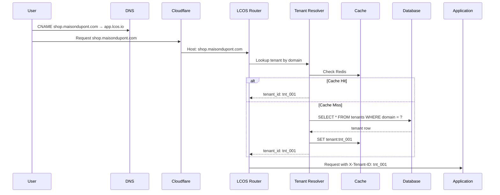

# Multi-Tenant Architecture

> **Version:** 1.0.0  
> **Status:** Approved  
> **Last Updated:** 2026-07-21  

---

## 1. Overview

LCOS serves multiple luxury commerce brands as isolated tenants within a single application instance. Each tenant represents an independent business entity (e.g., "Maison Dupont", "Cartier", "Bulgari") with its own data, configuration, users, and custom domain.

### Design Principles

- **Tenant isolation first** — no data leaks between tenants, even under failure
- **Row-level security** via `tenantId` on every table
- **Shared infrastructure** for cost efficiency at scale
- **Configurable isolation** — option to upgrade to dedicated database per tenant at higher tiers
- **Zero-touch provisioning** — new tenants created programmatically with no ops involvement

---

## 2. Tenant Isolation Strategy

### Primary Model: Row-Level Isolation

Every table in the shared database includes a `tenant_id` column (UUID, foreign key to `tenants.id`). All queries enforce `WHERE tenant_id = :currentTenantId` via:

1. **Application-level middleware** — the API gateway extracts `X-Tenant-ID` from every request and injects it into the query context
2. **PostgreSQL Row-Level Security (RLS)** — database-level policy as a safety net:

```sql
ALTER TABLE products ENABLE ROW LEVEL SECURITY;
CREATE POLICY tenant_isolation ON products
  USING (tenant_id = current_setting('app.current_tenant_id')::UUID);
```

3. **ORM default scopes** — all repository/DAO methods automatically scope to the current tenant, making it impossible for a developer to forget the filter

### Secondary Model: Dedicated Database (Enterprise Tier)

For tenants requiring PCI Level 1, GDPR data residency, or extreme throughput, a per-tenant PostgreSQL database is provisioned. The application router connects to the appropriate database based on `tenants.database_url`.

### Data Separation Decision Matrix

| Aspect | Row-Level (Standard) | Dedicated DB (Enterprise) |
|--------|----------------------|---------------------------|
| Cost | Shared, lowest | Higher, per-tenant |
| Isolation | Logical + RLS | Physical |
| Migration | All tenants migrate together | Individual tenant migrations |
| Cross-tenant analytics | Requires filter | Union across databases |
| Compliance | Good | Best (PCI, GDPR) |
| Max tenants per shard | 5,000 | Unlimited |

---

## 3. Database Schema

### `tenants` Table

```sql
CREATE TABLE tenants (
  id            UUID PRIMARY KEY DEFAULT gen_random_uuid(),
  name          VARCHAR(255) NOT NULL,
  slug          VARCHAR(100) NOT NULL UNIQUE,
  domain        VARCHAR(255) UNIQUE,
  logo_url      TEXT,
  favicon_url   TEXT,
  plan_id       VARCHAR(50) NOT NULL,          -- 'starter', 'professional', 'enterprise'
  status        VARCHAR(20) NOT NULL DEFAULT 'active',  -- 'active', 'suspended', 'trial'
  locale        VARCHAR(10) DEFAULT 'en-US',
  timezone      VARCHAR(50) DEFAULT 'UTC',
  settings      JSONB DEFAULT '{}',
  feature_flags JSONB DEFAULT '{}',
  database_url  TEXT,                           -- null for row-level, set for dedicated
  created_at    TIMESTAMPTZ NOT NULL DEFAULT NOW(),
  updated_at    TIMESTAMPTZ NOT NULL DEFAULT NOW()
);
```

### All Tenant-Scoped Tables

Every entity table includes `tenant_id`:

```sql
CREATE TABLE products (
  id         UUID PRIMARY KEY DEFAULT gen_random_uuid(),
  tenant_id  UUID NOT NULL REFERENCES tenants(id) ON DELETE CASCADE,
  name       VARCHAR(255) NOT NULL,
  -- ... other columns
  created_at TIMESTAMPTZ NOT NULL DEFAULT NOW()
);

CREATE INDEX idx_products_tenant ON products(tenant_id);
```

Tables shared globally (not tenant-scoped):
- `plans` — subscription plan definitions
- `feature_flags_catalog` — master feature list
- `migrations` — schema migration history

---

## 4. Tenant Provisioning Flow

```
                    ┌──────────────────┐
                    │   Registration   │
                    │   POST /auth/    │
                    │   register       │
                    └────────┬─────────┘
                             │
                             ▼
                    ┌──────────────────┐
                    │ 1. Validate slug │
                    │    uniqueness    │
                    └────────┬─────────┘
                             │
                             ▼
                    ┌──────────────────┐
                    │ 2. Create tenant │
                    │    record        │
                    └────────┬─────────┘
                             │
                             ▼
                    ┌──────────────────┐
                    │ 3. Create tenant │
                    │    admin user    │
                    └────────┬─────────┘
                             │
                             ▼
                    ┌──────────────────┐
                    │ 4. Provision     │
                    │    defaults      │
                    └────────┬─────────┘
                             │
                             ▼
                    ┌──────────────────┐
                    │ 5. Configure     │
                    │    domain        │
                    └────────┬─────────┘
                             │
                             ▼
                    ┌──────────────────┐
                    │ 6. Send welcome │
                    │    email         │
                    └──────────────────┘
```

### Step Details

**1. Validate** — The `slug` is checked against the `tenants` table and a reserved-slugs list (e.g., "api", "admin", "app"). Slugs must be 3-50 alphanumeric + hyphens.

**2. Create tenant record** — Insert into `tenants` with plan `starter`, status `trial`, and default settings.

**3. Create admin user** — Insert into `users` with role `tenant_admin`, linked to the new `tenant_id`.

**4. Provision defaults** — Seed data is inserted:
- Default category tree (Rings, Necklaces, Bracelets, Earrings, Watches, Accessories)
- Default warehouses (Primary Warehouse)
- Default automation templates (Abandoned Cart, Welcome Series)
- Default user roles and permissions
- Default brand record

**5. Domain configuration** — If a custom domain was provided, a CNAME record is verified and the domain is linked to the tenant. SSL certificate is provisioned via Let's Encrypt.

**6. Welcome** — Send onboarding email with setup wizard link, quick-start guide, and API documentation.

### Provisioning via Back-Office API

```http
POST /admin/tenants
Content-Type: application/json
Authorization: Bearer <super_admin_token>

{
  "name": "Maison Dupont",
  "slug": "maison-dupont",
  "plan": "professional",
  "domain": "shop.maisondupont.com",
  "adminEmail": "admin@maisondupont.com",
  "adminFullName": "Jean Dupont",
  "locale": "fr-FR"
}
```

---

## 5. Custom Domain Support

### How It Works



### Domain Verification Flow

1. Tenant enters domain in settings (e.g., `shop.maisondupont.com`)
2. System generates a DNS verification record: `_lcos-verify.shop.maisondupont.com TXT "lcos-verify=tnt_001:abc123"`
3. Tenant adds the record via their DNS provider
4. System verifies the TXT record (cron job, checks every 5 min, expires after 72h)
5. On success: SSL cert is provisioned, domain is linked, `tenants.domain` is updated
6. Instructions: `CNAME shop.maisondupont.com → app.lcos.io` (or `proxy.lcos.io` for dedicated IP)

### SSL

- Automatic via Let's Encrypt with Certbot
- Wildcard cert `*.lcos.io` for subdomain tenants
- Individual certs for custom domains
- Auto-renewal (cron job, 30-day check)

---

## 6. Plan Management & Feature Flags

### Plan Definitions

Plans are stored in the `plans` table and cached:

| Plan | Price | Max Users | Max Products | Max API Calls | Storage | Isolation | AI Credits |
|------|-------|-----------|--------------|---------------|---------|-----------|------------|
| Starter | €199/mo | 5 | 500 | 10K/mo | 5GB | Row-level | 10K tokens/mo |
| Professional | €499/mo | 25 | 5,000 | 100K/mo | 50GB | Row-level | 100K tokens/mo |
| Enterprise | Custom | Unlimited | Unlimited | Unlimited | 500GB | Dedicated DB option | Custom |

### Feature Flag System

Feature flags are defined in a global catalog:

```json
{
  "ai_product_descriptions": { "plans": ["professional", "enterprise"], "beta": false },
  "whatsapp_marketing": { "plans": ["professional", "enterprise"], "beta": false },
  "multi_warehouse": { "plans": ["enterprise"], "beta": true },
  "custom_reports": { "plans": ["professional", "enterprise"], "beta": false },
  "white_glove_fulfillment": { "plans": ["enterprise"], "beta": false },
  "api_webhooks": { "plans": ["professional", "enterprise"], "beta": false }
}
```

Each tenant can also have overridden flags:

```json
// tenants.feature_flags
{
  "ai_product_descriptions": true,
  "multi_warehouse": true  // beta override for early adopter
}
```

### Enforcement

- **API layer:** middleware checks `tenants.feature_flags` before allowing access to feature endpoints
- **UI layer:** feature flags are included in the session response; frontend conditionally renders UI
- **Plan change:** upgrading/downgrading updates `tenants.plan_id`, which recalculates flags on next request

---

## 7. Cross-Tenant Considerations

### Data Sharing

By default, tenants are fully isolated. Limited cross-tenant features exist:

- **Public catalogs** — A super-admin can mark products/categories as "public template" for sharing across tenants
- **Integration partners** — Shared integration tokens (e.g., Stripe) are stored in a global `integration_credentials` table with `tenant_id` null
- **Analytics aggregates** — LCOS corporate can view anonymous aggregate metrics across tenants

### Super Admin Access

A separate `users` table includes a `super_admin` role that bypasses tenant scoping:

- Cannot read tenant data without explicit tenant context
- Has a special dashboard to manage all tenants
- All super admin actions are logged to `audit_log` with `actor_type = 'super_admin'`

### Audit Log

The `audit_log` table is NOT tenant-scoped (it's global):

```sql
CREATE TABLE audit_log (
  id          UUID PRIMARY KEY DEFAULT gen_random_uuid(),
  tenant_id   UUID REFERENCES tenants(id),    -- nullable for system actions
  actor_id    UUID REFERENCES users(id),
  actor_type  VARCHAR(20) DEFAULT 'tenant',   -- 'tenant', 'super_admin', 'system'
  action      VARCHAR(100) NOT NULL,
  resource    VARCHAR(100) NOT NULL,
  resource_id UUID,
  details     JSONB,
  ip_address  INET,
  user_agent  TEXT,
  created_at  TIMESTAMPTZ NOT NULL DEFAULT NOW()
);
```

---

## 8. Tenant Resolver Middleware

Pseudo-code for the tenant resolution middleware:

```typescript
async function tenantMiddleware(req: Request, res: Response, next: NextFunction) {
  // Resolution order: 1) Header  2) Subdomain  3) Custom domain
  const tenantId = req.headers['x-tenant-id']
    || await resolveFromSubdomain(req.hostname)
    || await resolveFromCustomDomain(req.hostname);

  if (!tenantId) {
    return res.status(400).json({ error: { code: 'MISSING_TENANT', message: 'X-Tenant-ID header or valid domain required' } });
  }

  const tenant = await tenantCache.get(tenantId);
  if (!tenant || tenant.status !== 'active') {
    return res.status(403).json({ error: { code: 'TENANT_INACTIVE', message: 'Tenant is suspended or not found' } });
  }

  req.tenant = tenant;
  req.tenantId = tenantId;

  // Inject for RLS
  await db.query(`SET app.current_tenant_id = '${tenantId}'`);

  next();
}
```

---

## 9. Migration Considerations

When using row-level isolation, all schema migrations apply to the shared database. The migration tool must:

1. Apply schema changes to the shared database
2. Backfill `tenant_id` on any new tables that require it
3. Update RLS policies if needed

For dedicated-database tenants, each tenant's database runs migrations independently during off-peak hours.

---

## 10. Backup & Recovery

| Isolation Mode | Backup Strategy | RPO | RTO |
|----------------|-----------------|-----|-----|
| Row-level | Daily pg_dump of shared DB | 24h | 4h |
| Dedicated DB | Point-in-time recovery (WAL archiving) | 5min | 1h |

In both cases, `tenants` table is backed up separately every hour (small, critical table).

---

## 11. Tenant Lifecycle

### Suspension

On payment failure or ToS violation:

1. `tenants.status` set to `suspended`
2. API returns `403` with code `TENANT_SUSPENDED`
3. Custom domain returns a static "Account suspended" page
4. Data is preserved for 30 days (grace period)
5. After 30 days, data is archived to cold storage

### Deletion

On tenant deletion request:

1. 14-day soft-delete with `status = 'pending_deletion'`
2. Scheduled job hard-deletes after 14 days
3. Archive a final database dump to encrypted S3 before deletion
4. Remove custom domain DNS and SSL certs
5. Send confirmation email to tenant admin
