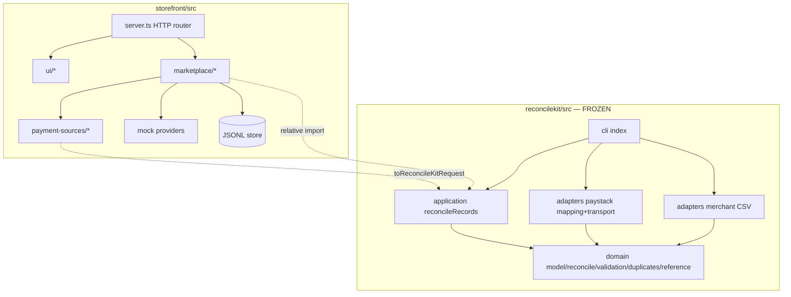

# RECONCILE KIT — COMPLETE REPOSITORY STATE & HANDOFF

**Report type:** Read-only repository audit (implementation, config, tests, docs).
**Audit date:** 2026-09-12.
**Auditor method:** read-only inspection + safe execution of existing validation commands. **No source, config, dependency, or existing report was modified.**
**Evidence labels used throughout:** `VERIFIED FROM SOURCE`, `VERIFIED BY TEST`, `VERIFIED BY INTEGRATION TEST`, `HISTORICAL CLAIM NOT REVERIFIED`, `INFERRED`, `UNKNOWN`, `BLOCKED BY MISSING ACCESS`.

> This document is a **new** audit file. It did not exist before this audit and no existing report was overwritten.

---

## 1. Executive summary

ReconcileKit is a **provider-neutral, CLI-first TypeScript reconciliation engine** (`reconcilekit/`) plus a **simulated digital-services marketplace/storefront** (`reconcilekit/storefront/`) that consumes the engine to demonstrate payment/ledger/fulfillment "three-truth" reconciliation.

- **Core engine** — `VERIFIED FROM SOURCE`: domain → application → adapters/CLI dependency direction holds; the domain has **zero external runtime imports**; the only third-party runtime dependency is `csv-parse@7.0.2`, confined to the merchant CSV adapter.
- **Storefront/marketplace** — `VERIFIED FROM SOURCE`: raw `node:http` server, append-only JSONL persistence, mock providers only, a working Payment Source Layer (`payment-sources/*`), and a reconcile bridge that feeds the frozen core.
- **Validation, current run (this audit)** — `VERIFIED BY TEST`: core/root `node --test` = **654/654 pass, 0 fail**; storefront `node --test` = **441/441 pass, 0 fail**; both typechecks **PASS**; ESLint **PASS** (JS-only config); Prettier `format:check` **FAIL** on 153 files **due to CRLF line-endings** (passes under `--end-of-line auto`) — an environment artifact, not a code-style defect.
- **Phases** — Phase 2A–2K implemented (per docs); Phase 3A = **PASS WITH CONDITIONS** (non-blocking, presentation-only); Phase 3B and 3C accepted. **Phase 3D is gated on "≥1 real mismatch from 3A", which the documentation does not prove was surfaced.**
- **Classification** — a **local, deterministic prototype / demo pilot** with a test-mode-capable Paystack path. **Not production-ready** (no auth, no DB, no deployment, no webhooks).

---

## 2. Repository identity and Git state

`VERIFIED FROM SOURCE` (commands run at the workspace root and from `reconcilekit/`):

| Item                              | Value                                                                                                                                                                     |
| --------------------------------- | ------------------------------------------------------------------------------------------------------------------------------------------------------------------------- |
| Absolute repository root          | `C:\Users\1040 G8\Documents\jarvis-demo`                                                                                                                                  |
| Current working directory (audit) | `C:\Users\1040 G8\Documents\jarvis-demo`                                                                                                                                  |
| Branch                            | `main`                                                                                                                                                                    |
| HEAD commit                       | `1eb41f32630dd651d0268bd445b647aa8cb6acd2` (`fix(wf01): duplicate response echoes persisted lead_id (F2)`)                                                                |
| ReconcileKit location             | nested directory `reconcilekit/` **inside the same Git work tree** (no `.git` of its own; `git rev-parse --show-toplevel` from `reconcilekit/` resolves to `jarvis-demo`) |
| Submodules                        | none observed for reconcilekit (`BLOCKED BY MISSING ACCESS` to confirm `.gitmodules`; no `.gitmodules` surfaced)                                                          |
| Package manager                   | npm (both `package.json`/`package-lock.json` present); a repo-root `pnpm-workspace.yaml` + `pnpm-lock.yaml` exist but are **not** used by reconcilekit                    |
| Other agents                      | No evidence of a concurrent agent editing reconcilekit during this audit; pre-existing uncommitted work is present and must be protected (§3)                             |

Recent commits (`git log --oneline -8`) are all unrelated to ReconcileKit (n8n lead-recovery workflow work), confirming ReconcileKit's last committed state predates the current uncommitted reconcilekit changes.

---

## 3. Inspection scope and limitations

**Working tree that must be protected** (`git status --short`, `VERIFIED FROM SOURCE`) — reconcilekit-relevant entries only:

- Modified (tracked): `reconcilekit/storefront/package.json` (adds `pilot:run`), `reconcilekit/docs/PHASE_3B_ACCEPTANCE_REPORT.md`, `reconcilekit/storefront/src/ui/client.ts`, `reconcilekit/storefront/src/ui/customer-pages.ts`, `reconcilekit/storefront/src/ui/layout.ts`.
- Untracked: `reconcilekit/docs/PHASE_3A_*` (9 files), `reconcilekit/docs/PHASE_3C_ACCEPTANCE_REPORT.md`, **15 `docs/* - Copy.md` duplicates**, `reconcilekit/storefront/src/cli/`, `reconcilekit/storefront/test/cli/`, `reconcilekit/storefront/test/fixtures/synthetic-paystack-verify.json`, `reconcilekit/storefront/test/marketplace/transaction-detail-states.test.ts`.
- Unrelated surviving changes elsewhere in the monorepo (must not be touched): `agency-os/`, `_open-canva/`, `n8n-lead-recovery/`, `workflows/`, root `package.json`/`package-lock.json`/`.gitignore`.

**Limitations:**

- Live/network behavior of the Paystack transport and storefront Paystack client was **not** exercised (no external calls made).
- `reconcilekit/storefront/.env` exists and is gitignored; it was **not** opened (secret safety). Only `.env.example` semantics were read.
- Exact catalog product count is `UNKNOWN` at source level (see §17); test bounds only were verified.
- Historical test counts and phase acceptance claims are `HISTORICAL CLAIM NOT REVERIFIED` unless restated as current-run results in §15.

---

## 4. Complete repository structure

ReconcileKit is self-contained under `reconcilekit/`. `VERIFIED FROM SOURCE`:

```text
reconcilekit/
  package.json  package-lock.json  tsconfig.json  eslint.config.js  .prettierrc.json  .gitignore
  ARCHITECTURE.md  CANONICAL-DOMAIN-MODEL-v0.3.md  DOMAIN-DECISIONS-v0.2.md
  RECONCILIATION-DOMAIN.md  PACKAGE-DEPENDENCY-SPECIFICATION.md
  PACKAGE-CANDIDATE-EVALUATION-v0.1.md  PAYSTACK-EVIDENCE-VALIDATION.md
  PILOT-READINESS-REPORT.md  PROJECT.md  README.md
  RECONCILE-KIT-PAYMENT-SOURCE-LAYER-ADDENDUM.md
  RECONCILE-KIT-PAYMENT-SOURCE-LAYER-OPENCODE-PROMPT.md
  merchant.csv  merchant-reconcilekit.csv        # synthetic fixtures
  src/                                            # CORE (22 files incl. co-located tests)
    domain/       model.ts reference.ts reconcile.ts duplicates.ts validation.ts fixtures.ts (+tests)
    application/  reconcile-records.ts (+test)
    adapters/     merchant/csv.ts ; providers/paystack/{paystack,transport}.ts (+tests)
    cli/          index.ts (+index.test.ts, ux.test.ts)
    integration/  end-to-end.test.ts  source-attributes.test.ts
  storefront/                                     # SIBLING PILOT PACKAGE
    package.json  package-lock.json  tsconfig.json  README.md
    src/          config.ts ids.ts main.ts server.ts
                  domain/types.ts application/verify-order.ts
                  store/ paystack/ reconcile/ reconcile/ view.ts
                  marketplace/  (see §5)  payment-sources/  providers/  ui/  cli/pilot-run.ts
    test/         (~40 suites; marketplace/, cli/, fixtures/)
    data/         (gitignored runtime JSONL)
  docs/           (phase plans, acceptance/freeze reports, architecture docs; + 15 " - Copy.md")
```

Root `node_modules/` present in both `reconcilekit/` and `reconcilekit/storefront/` (`VERIFIED FROM SOURCE`: directories exist). No `dist/`, `build/`, Dockerfile, or CI workflow was found under `reconcilekit/` (`VERIFIED FROM SOURCE` by directory listing).

---

## 5. Project / package inventory

| Package          | Path                       | Name@version                    | Type                  | Entry / bin                                                             |
| ---------------- | -------------------------- | ------------------------------- | --------------------- | ----------------------------------------------------------------------- |
| Core engine      | `reconcilekit/`            | `reconcilekit@0.1.0`            | ESM library + CLI     | `bin: reconcilekit → ./src/cli/index.ts` (runs via Node type-stripping) |
| Storefront pilot | `reconcilekit/storefront/` | `reconcilekit-storefront@0.1.0` | ESM app (HTTP server) | `main.ts` via `npm start`; `cli/pilot-run.ts` via `pilot:run`           |

`VERIFIED FROM SOURCE` (both `package.json` files). Both are `"private": true`, `"type": "module"`, `engines.node >=24.12.0`. There is **no** npm/pnpm workspace linking the two: the storefront does **not** declare `reconcilekit` as a dependency; it imports the core via **relative paths** (`../../../domain/model.ts`, etc.), which is possible because both live under the same TypeScript project tree and Node resolves `.ts` by relative specifier.

---

## 6. Exact technology stack

`VERIFIED FROM SOURCE`:

**Shared**

- Runtime: **Node.js ≥ 24.12.0** (native TypeScript type-stripping; `erasableSyntaxOnly`).
- Language: **TypeScript 7.0.2** (devDependency).
- Module system: **ESM**, `module`+`moduleResolution` = `nodenext`; `.ts` import specifiers (`allowImportingTsExtensions`).
- Type checking: `tsc --noEmit` (no build output; both packages are `noEmit`).
- Tests: **`node:test`** (`node --test`), co-located for the core and under `storefront/test/`.
- Lint: **ESLint 10.8.1** (`@eslint/js`) — configured to lint **only** `*.js/*.cjs/*.mjs` (TypeScript sources are not linted).
- Format: **Prettier 3.9.6** with an empty `.prettierrc.json` (defaults; default `endOfLine: "lf"`).

**Core engine**

- Runtime deps: **`csv-parse@7.0.2` only**.
- No HTTP framework (Paystack transport uses global `fetch`/`URL`/`Headers`).
- No database, no ORM, no filesystem in domain/application (filesystem only in `cli/index.ts`).

**Storefront**

- Runtime deps: **none declared** (Node built-ins only: `node:http`, `node:fs`, `node:path`, `node:crypto`, `node:url`, `process.env`).
- HTTP: raw `node:http` (`createStorefrontServer`, `server.ts`).
- Persistence: **append-only JSONL** (`store/jsonl-store.ts`).
- Frontend: server-rendered HTML strings with inline CSS/JS (`ui/styles.ts` → `/assets/app.css`, `/assets/app.js`). No React/Next/Vite/bundler.

---

## 7. Dependencies and lockfiles

`VERIFIED FROM SOURCE` (`package.json`); lockfiles present: `reconcilekit/package-lock.json`, `reconcilekit/storefront/package-lock.json`.

**Core (`reconcilekit/package.json`)**

- dependencies: `csv-parse@7.0.2`.
- devDependencies: `@eslint/js@10.0.1`, `@types/node@24.13.3`, `eslint@10.8.1`, `prettier@3.9.6`, `typescript@7.0.2`.

**Storefront (`storefront/package.json`)**

- dependencies: none.
- devDependencies: `@types/node@24.13.3`, `typescript@7.0.2`.

All versions are **exact pins** (no `^`/`~` ranges). `INFERRED` (not independently verified): lockfiles pin transitive trees reproducibly. `node_modules/` presence in both packages indicates dependencies were installed; **installation was not performed or modified** during this audit.

---

## 8. Configuration and environment requirements

`VERIFIED FROM SOURCE` (`storefront/src/config.ts`, `storefront/README.md`, `storefront/.env.example`):

| Variable                         | Default                   | Purpose                                     |
| -------------------------------- | ------------------------- | ------------------------------------------- |
| `STOREFRONT_PORT`                | `8787`                    | HTTP port (validated 1–65535)               |
| `STOREFRONT_DATA_DIR`            | `<storefront>/data`       | JSONL data directory                        |
| `STOREFRONT_SEED_DEMO`           | —                         | `1`/`true`/`yes` seeds 16 demo scenarios    |
| `STOREFRONT_PAYSTACK_SECRET_KEY` | —                         | Paystack secret (legacy surface only)       |
| `STOREFRONT_PAYSTACK_BASE_URL`   | `https://api.paystack.co` | Paystack base URL (absolute HTTPS enforced) |
| `STOREFRONT_CALLBACK_BASE_URL`   | `http://localhost:<port>` | Callback base URL                           |

- Core CLI env var: **`RECONCILEKIT_PAYSTACK_SECRET_KEY`** (live mode only; `ARCHITECTURE.md` §38.3).
- The app never loads `.env` itself; `npm start` runs `node --env-file-if-exists=.env src/main.ts`.
- `reconcilekit/storefront/.env` exists (gitignored) and `.env.example` exists. Values were not read (secret safety).
- The workspace root `jarvis-demo/.env` exists too (out of ReconcileKit scope; not read).

---

## 9. Repository development rules

**A. Explicitly documented rules** (`HISTORICAL CLAIM NOT REVERIFIED` unless noted; sources cited):

- Domain-first, provider-neutral, deterministic, dependency-inversion, local-first — `ARCHITECTURE.md` §2.
- Domain must not import Paystack/HTTP/CLI/filesystem/DB/ORM — `ARCHITECTURE.md` §4.1, §6.
- Exact-reference matching only; no fuzzy matching — `CANONICAL-DOMAIN-MODEL-v0.3.md` §10, `ARCHITECTURE.md` §7.
- Duplicate candidates never arbitrarily paired — `CANONICAL-DOMAIN-MODEL-v0.3.md` §13.
- Integer minor units + explicit currency; no float money — §9 of the same.
- Missing ≠ unknown; input errors ≠ discrepancies — §7/§12.
- Persistence not part of MVP architecture; do not introduce PostgreSQL/Prisma/Redis/migrations — `ARCHITECTURE.md` §24.
- Secrets must never be stored/logged/reported; live CLI reads secret only from env, never as arg/file — `ARCHITECTURE.md` §26, §38.3.
- Payment Source Layer must not add fuzzy matching or make a provider reference the transaction anchor — `RECONCILE-KIT-PAYMENT-SOURCE-LAYER-ADDENDUM.md` §20–21.
- Live-Paystack CLI contract (`--live-paystack` opt-in, mutually exclusive with `--provider`, exit code 1 on missing secret) — `ARCHITECTURE.md` §38.
- Storefront: no auth, no real payments, no real provider credentials needed for the demo; admin shell is a simulated operator surface — `storefront/README.md`.

**B. Rules enforced by configuration:** ESM-only (`type: module`); `strict` + `verbatimModuleSyntax` + `erasableSyntaxOnly` + `allowImportingTsExtensions` (`tsconfig.json`); exact dependency pins.

**C. Rules enforced by tests:** determinism/byte-identical reports; no arbitrary duplicate pairing; integer-only money; missing-vs-unknown distinction; input-error precedence; `reconcilekit/src/**` untouched by storefront work (`VERIFIED BY TEST` — see §12/§20).

**D. Conventions observed in code (`VERIFIED FROM SOURCE`):** co-located `*.test.ts` for the core; `storefront/test/**` for the app; `.ts` relative import specifiers; typed error classes per module; append-only event/ledger writes; deterministic ids via FNV-style hashing (`storefront/src/ids.ts`).

**E. Recommendations (NOT established rules):** enable TypeScript-based ESLint; add `.prettierrc` `endOfLine` policy or `.gitattributes` normalization; remove ` - Copy.md` duplicates; re-baseline test-count guards.

**Conflicts:** `PROJECT.md` says "pre-coding / domain validation" while the code and Phase 2 freeze say implemented — the freeze/implementation evidence is authoritative (see §23).

---

## 10. Architecture and dependency boundaries

**Core dependency direction — `VERIFIED FROM SOURCE`:**

```text
CLI (src/cli/index.ts: node:fs/util/url, process.env)
  → application/reconcile-records.ts  (reconcileRecords)
      → domain/reconcile.ts  (reconcile)
          → domain/{model,reference,duplicates,validation}.ts
  → adapters/merchant/csv.ts           (csv-parse/sync only)
  → adapters/providers/paystack/*.ts   (paystack.ts mapping pure; transport.ts = global fetch)
```

- `domain/*` imports only other `domain/*` — **no external imports**. `application/*` imports only `domain/*`. Adapters import `domain/*`; domain never imports adapters/application. `INFERRED`: the dependency-inversion rule is enforced by this import graph.
- Paystack knowledge is isolated to `adapters/providers/paystack/*`. Filesystem only in `cli/index.ts`. No database anywhere.

**Storefront architecture — `VERIFIED FROM SOURCE`:**

```text
server.ts (node:http router)
  → ui/* (render pages, view-models in client.ts)
  → application/verify-order.ts (legacy Paystack acquisition)
  → marketplace/*  (catalog, transactions orchestration, wallet/ledger,
        providers (mock), payment-sources/*, reconcile-bridge, truth,
        evidence, receipts, resolution, timeline, ticketing, artifacts)
  → store/jsonl-store.ts (25 JSONL collections)
  → (relative import) reconcilekit/src/domain + application (frozen engine)
```



State-transition ownership (`VERIFIED FROM SOURCE`): payment-lifecycle state machine + ledger are in `marketplace/wallet.ts` (sole writer of ledger entries); transaction status derivation in `marketplace/transactions.ts`; truth projection in `marketplace/truth.ts`; reconciliation result persistence in `marketplace/reconcile.ts`. Error propagation uses typed error classes per module; the core wraps unexpected domain throws in `ApplicationError`.

---

## 11. Frozen decisions and protected files

`HISTORICAL CLAIM NOT REVERIFIED` (docs) + `VERIFIED FROM SOURCE` (imports/tests):

| Constraint                                                                                                                 | Status                                 | Evidence                                                                    |
| -------------------------------------------------------------------------------------------------------------------------- | -------------------------------------- | --------------------------------------------------------------------------- |
| Provider-neutral core                                                                                                      | Enforced by code                       | domain has no Paystack imports                                              |
| Marketplace outside domain reconciliation logic                                                                            | Enforced by code                       | storefront imports core, not vice versa                                     |
| Payment adapters outside core domain                                                                                       | Enforced by code                       | Paystack only in `adapters/providers/paystack`                              |
| `reconcileRecords()` sole matcher (exact reference only)                                                                   | Enforced by tests                      | `reconcile-records.test.ts`, `reconcile.test.ts`, `invariants.test.ts`      |
| Canonical transaction contracts / identifier hierarchy (`mk_txn_` join anchor; `txn_` display; `wld_`/`ps_` evidence-only) | Documented + implemented in storefront | `PHASE_2_ACCEPTANCE_AND_ARCHITECTURE_FREEZE.md` §5; `storefront/src/ids.ts` |
| Three separate truths (payment/ledger/fulfillment) never collapsed                                                         | Enforced by tests                      | `truth.test.ts`, `transaction-detail-states.test.ts`                        |
| Append-only ledger-authoritative wallet                                                                                    | Enforced by code                       | `wallet.ts`, `store/jsonl-store.ts`                                         |
| No unnecessary runtime deps to core                                                                                        | Enforced by config                     | only `csv-parse`                                                            |
| No new DB/framework without architectural need                                                                             | Enforced by config/docs                | no DB deps; `ARCHITECTURE.md` §24                                           |
| Idempotency and traceability                                                                                               | Enforced by tests                      | `ingest.ts` (`pevt_`), `transaction-detail-states`/`demo-scenarios` replay  |
| No silent state-meaning changes                                                                                            | Documented                             | freeze §9                                                                   |

**Exact files/contracts to protect:**

- `reconcilekit/src/**` (entire core), especially `domain/model.ts` (`NormalizedPayment`, `MerchantPayment`, `ProviderPayment`, outcome/code vocabulary), `domain/reconcile.ts`, `application/reconcile-records.ts`.
- Storefront contract files: `marketplace/types.ts`, `marketplace/wallet.ts` (ledger semantics), `marketplace/reconcile-bridge.ts` (join-key rule), `payment-sources/{types,ingest,to-reconcilekit}.ts`, `ids.ts` (identifier hierarchy).
- Frozen docs: `CANONICAL-DOMAIN-MODEL-v0.3.md`, `ARCHITECTURE.md`, `docs/PHASE_2_ACCEPTANCE_AND_ARCHITECTURE_FREEZE.md`.

**Note on "permanent freeze":** `PROJECT.md` still declares "pre-coding", so the freeze is contradicted by one earlier doc (§23); the freeze is nonetheless consistent with the actual implementation.

---

## 12. Phase-status matrix

`VERIFIED BY TEST` = current-run test evidence; otherwise documented. Phase 2 order per `PHASE_2_IMPLEMENTATION_PLAN.md` §O: **2A…2K** (`2F` = ReconcileKit Integration).

| Phase                                    | Objective                                | Implemented files (evidence)                                                                      | Test evidence                                                                                   | Status                                                                                |
| ---------------------------------------- | ---------------------------------------- | ------------------------------------------------------------------------------------------------- | ----------------------------------------------------------------------------------------------- | ------------------------------------------------------------------------------------- |
| 2A Foundation/domain model               | Types + invariants                       | `storefront/src/domain/types.ts`, `marketplace/types.ts`                                          | `types.test.ts`, `store.test.ts`                                                                | **VERIFIED COMPLETE**                                                                 |
| 2B Mock provider contracts               | Provider boundary                        | `providers/{contracts,mock-provider,registry}.ts`                                                 | `provider-registry.test.ts`, `mock-provider.test.ts`, `payment-provider.test.ts`                | **VERIFIED COMPLETE**                                                                 |
| 2C Mock wallet/payment + legacy Paystack | Wallet + Paystack acquisition            | `wallet.ts`, `paystack/*`, `application/verify-order.ts`                                          | `wallet.test.ts`, `wallet-lifecycle.test.ts`, `verify-order.test.ts`, `paystack-client.test.ts` | **VERIFIED COMPLETE**                                                                 |
| 2D Marketplace catalog                   | Categories/services/products             | `catalog.ts`                                                                                      | `catalog.test.ts`                                                                               | **VERIFIED COMPLETE**                                                                 |
| 2E Transaction orchestration             | Checkout orchestration                   | `transactions.ts`                                                                                 | `transactions.test.ts`                                                                          | **VERIFIED COMPLETE**                                                                 |
| 2F ReconcileKit integration              | Bridge to core                           | `reconcile-bridge.ts`, `reconcile.ts`                                                             | `reconcile-bridge.test.ts`, `reconcile.test.ts`                                                 | **VERIFIED COMPLETE** (functionally exercised by current 654/441 runs)                |
| 2G Timeline/evidence/refund/dispute UX   | Evidence + resolution                    | `timeline.ts`, `evidence.ts`, `resolution.ts`, `receipts.ts`                                      | `evidence.test.ts`, `resolution.test.ts`, `timeline.test.ts`                                    | **VERIFIED COMPLETE**                                                                 |
| 2H Ticketing/gift-card                   | Artifacts                                | `ticketing.ts`, `artifacts.ts`, `gift-card.test.ts`                                               | `ticketing.test.ts`, `gift-card.test.ts`                                                        | **VERIFIED COMPLETE**                                                                 |
| 2I Customer + admin HTTP/UI              | Pages/routes                             | `server.ts`, `ui/*`                                                                               | `frontend-walkthrough.test.ts`, `server.test.ts`, `reconcile-server.test.ts`                    | **VERIFIED COMPLETE**                                                                 |
| 2J Seed/demo scenarios                   | Determinism                              | `seed.ts`, `demo-scenarios.ts`                                                                    | `seed.test.ts`, `demo-scenarios.test.ts`                                                        | **VERIFIED COMPLETE**                                                                 |
| 2K Testing/hardening/handover            | Validation + docs                        | docs + `frontend-walkthrough.test.ts`                                                             | current runs                                                                                    | **VERIFIED COMPLETE**                                                                 |
| 3A Operational pilot                     | ≥2 operators reconcile real samples      | no source change (docs/CLI only): `storefront/src/cli/pilot-run.ts`, `test/cli/pilot-run.test.ts` | pilot findings docs (documentation-only increment)                                              | **PARTIALLY COMPLETE** — `PASS WITH CONDITIONS`, both non-blocking, presentation-only |
| 3B Merchant CSV intake                   | CSV → `PaymentEventInput` (exactly-once) | `payment-sources/csv-intake.ts` (+`manual-csv.ts`)                                                | `csv-intake.test.ts` 17                                                                         | **VERIFIED COMPLETE**                                                                 |
| 3C Transaction-truth surface             | Detail page states + masked evidence     | `ui/{client,customer-pages,layout}.ts`                                                            | `transaction-detail-states.test.ts` 9                                                           | **VERIFIED COMPLETE**                                                                 |
| 3D Mismatch investigation                | Mismatch workflow                        | —                                                                                                 | —                                                                                               | **NOT STARTED / BLOCKED** — entry gate "≥1 real mismatch from 3A" not evidenced       |
| 3E Webhooks                              | —                                        | —                                                                                                 | —                                                                                               | **NOT STARTED (gated)**                                                               |
| 3F Durable persistence                   | —                                        | —                                                                                                 | —                                                                                               | **NOT STARTED (gated)**                                                               |

**Phase-name discrepancy:** the plan defines `2A…2K`, and the `2K` report describes validating "2A–2J" while itself being the 2K validation phase — a doc-set inconsistency, not a functional contradiction (`PHASE_2K_…md`).

---

## 13. Completed functionality

`VERIFIED FROM SOURCE` (+ tests where noted):

- Deterministic exact-reference reconciliation engine with full outcome/code vocabulary (`src/domain/*`, `src/application/reconcile-records.ts`).
- Paystack mapping + paginated transport; merchant CSV adapter; CLI with text/JSON output, exit codes, live-Paystack opt-in.
- End-to-end core pipeline tests (`src/integration/end-to-end.test.ts`, `source-attributes.test.ts`).
- Storefront: catalog, checkout orchestration, wallet+ledger lifecycle, mock provider fulfillment, reconciliation bridge, evidence packs + masking, receipts, notifications, disputes/resolution, admin queues, customer/admin HTML.
- Payment Source Layer: generic `PaymentEvent`, idempotent `ingestPaymentEvent` (`pevt_…`), adapters (paystack/manual-csv/bank-transfer/wallet), `toReconcileKitRequest`, `wallet-ingest`, `csv-intake`.
- 16 deterministic demo scenarios seeded through the real execution + reconciliation path.

---

## 14. Verified working functionality (this audit's live runs)

`VERIFIED BY TEST` (commands run 2026-09-12 from the stated working dirs):

| Check                | Command                                                 | Result                                                                      |
| -------------------- | ------------------------------------------------------- | --------------------------------------------------------------------------- |
| Core/root tests      | `npm test` in `reconcilekit/` (recursive `node --test`) | **654 tests, 654 pass, 0 fail**                                             |
| Storefront tests     | `npm test` in `reconcilekit/storefront/`                | **441 tests, 441 pass, 0 fail**                                             |
| Root typecheck       | `npm run typecheck` in `reconcilekit/`                  | **PASS** (`tsc --noEmit`, no output)                                        |
| Storefront typecheck | `npm run typecheck` in `reconcilekit/storefront/`       | **PASS**                                                                    |
| ESLint               | `npm run lint` in `reconcilekit/`                       | **PASS** (no output; note: config covers only JS files)                     |
| Prettier             | `npm run format:check` in `reconcilekit/`               | **FAIL** — 153 files flagged (CRLF vs LF); passes with `--end-of-line auto` |

All tests are deterministic, in-memory/temp-dir (via `mkdtemp`), and use mock providers/fake Paystack gateways — **no real funds, no external networks**.

---

## 15. Test / build / type-check / lint results (detail)

- **Command / cwd / exit codes:** all four `npm` scripts above returned exit code 0 **except `format:check` (exit 1)**.
- **Type-check:** both projects `strict`, `noEmit`; clean.
- **Lint:** `eslint .` clean, but `eslint.config.js` restricts to `**/*.js|cjs|mjs` → **`.ts` sources are not linted** (`VERIFIED FROM SOURCE`). This is a coverage gap, not a failure.
- **Formatting failure classification:** **environment/tooling issue, not a product defect.** `VERIFIED FROM SOURCE`: working-tree files contain CRLF (`tsconfig.json` and `storefront/test/store.test.ts` each have CR count == LF count); `core.autocrlf=false`; `.gitattributes` = `* text=auto`; Prettier 3 default `endOfLine: "lf"`. Re-running with `--end-of-line auto` → **"All matched files use Prettier code style!"**.
- **No build step exists** (both packages `noEmit`); `npm run dev` referenced in `storefront/README.md` is **not** a script in `package.json` (`VERIFIED FROM SOURCE` doc/code disagreement).
- **Suites not executed:** no browser E2E, no live Paystack, no CLI subprocess against real data (only the in-repo node:test suites, which include CLI subprocess tests).

---

## 16. Marketplace implementation status

`VERIFIED FROM SOURCE` + `VERIFIED BY TEST`:

- 12 seeded categories (`catalog.test.ts` asserts `catalog.categories.length === 12`); services `>= 20` and products `>= 10` asserted; README claims "12 categories / 24 services". Exact service/product counts: `VERIFIED BY TEST` bounds only; exact figures `UNKNOWN`.
- Compliance gating: exactly one category is `COMPLIANCE_GATED` (BETTING) and checkout of gated services throws (`catalog.test.ts`).
- Providers: **mock only** (`providers/mock-provider.ts`), registry throws for gated `BETTING`. No real provider integration.
- User journey coverage: browse (`/catalog`), select (`/services/:id`), details (`/checkout`), order + payment evidence + wallet debit + mock fulfillment + reconcile + history/evidence all implemented and HTTP-covered; refunds/reversals/disputes implemented in `resolution.ts`.
- Legacy Paystack acquisition surface retained (JSON/CSV routes shadowed when marketplace deps present → `404 text/html`; behavior covered at application layer).

---

## 17. Reconcile Kit integration status

`VERIFIED FROM SOURCE`:

- **Join key:** `mk_txn_…` is used on both merchant and provider sides in `reconcile-bridge.ts`; provider references are **source attributes only, never join keys**.
- Provider rows are emitted only for definitive provider statuses; `PENDING`/`TIMEOUT` emit no provider row → engine yields `MISSING_PROVIDER_RECORD` rather than a fabricated outcome.
- Duplicate provider responses dedupe to `MATCH` with an app-level `DUPLICATE_PROVIDER_RESPONSE` marker.
- Integration is **synchronous** (in-process function calls), not network/async-queue.
- No type duplication of the canonical core types: storefront imports core `domain/model.ts` types by relative path.
- Reconciliation results are persisted as immutable evidence packs (`marketplace/reconcile.ts`); replay is store-only and idempotent.
- **Separation violations found:** none material. The `storefront/src/domain/types.ts` `PaymentRecord` (legacy boundary) coexists with the core `NormalizedPayment`; `storefront/src/reconcile/adapter.ts` maps legacy `PaymentRecord` → engine rows. This is an intentional legacy boundary, not a broken separation (`INFERRED`).

---

## 18. Payment source layer assessment

`VERIFIED FROM SOURCE`:

- **Addendum exists:** `RECONCILE-KIT-PAYMENT-SOURCE-LAYER-ADDENDUM.md` — header status **"Design patch for approval"** (stale; the layer is implemented).
- **Design validated?** Document asserts internal consistency with the canonical model (`§22`); no separate sign-off artifact found.
- **Implemented:** yes — `storefront/src/marketplace/payment-sources/*` (`types.ts`, `ingest.ts`, `to-reconcilekit.ts`, `wallet-ingest.ts`, `csv-intake.ts`, `adapters/{paystack,manual-csv,bank-transfer,wallet}.ts`) + tests (`payment-sources.test.ts`, `csv-intake.test.ts`).
- **Provider-neutral parts:** `PaymentEvent`, `PaymentEventInput`, `SourceConfidence`, `ingestPaymentEvent`, `toReconcileKitRequest`, all four adapters.
- **Paystack-specific parts:** `payment-sources/adapters/paystack.ts` (delegates to core `mapPaystackResponse`) and `storefront/src/paystack/client.ts`.
- **Internal references:** deterministic ids via `storefront/src/ids.ts` (`mk_txn_…`, `txn_…`, `wld_…`, `pevt_…`).
- **Universal anchor:** `mk_txn_…` in the marketplace layer (`ids.ts:46`); the core itself defines no prefixes.
- **Bank transfer:** supported only as a **data-shape adapter** (`bank-transfer.ts`) with no live bank integration; missing/incorrect reference → `MISSING_REFERENCE`/`MISSING_PROVIDER_RECORD` (no fuzzy matching).
- **Wallet accounting:** implemented (`wallet.ts`, derived balance from append-only ledger).
- **Ledger vs fulfillment states:** separate (`truth.ts` three-truth projection).
- **Manual ingestion:** yes (`manual-csv.ts`, `csv-intake.ts`).
- **Adapter extensibility:** yes — new sources implement `payment-sources/types.ts`; core unchanged.
- **Minimum correction for the prototype:** `UNKNOWN` at source level. The addendum header status is the only visible inconsistency to reconcile.

---

## 19. Complete transaction-flow trace

`VERIFIED FROM SOURCE` (function names/line numbers where read).

**Happy path (checkout → reconcile → surface):**

1. Customer checkout → `server.ts` marketplace router (`POST` checkout route) → `runCheckout` (`ui/client.ts:914`).
2. `executeMarketplaceTransaction` (`marketplace/transactions.ts:432`): validate service (`validateServiceInputs` :444), derive deterministic ids (`ids.ts`), replay-guard on existing transaction (:463).
3. Order persisted via `insertOrder` (:473); timeline events `OrderCreated` (:486) + `QuoteRecorded` (:503).
4. Initial transaction record persisted with `paymentStatus:"PENDING"`, `fulfillmentStatus:"NOT_STARTED"`, `adminStatus:"PENDING_PROVIDER"` (:520–535).
5. Wallet resolved (`resolveWallet` :537).
6. `runPaymentAndFulfillment` (:545) drives payment source + ledger + mock provider + persistence of final states.
7. Reconciliation: `reconcileMarketplaceTransaction` (`marketplace/reconcile.ts:136`) builds the engine request via `buildMarketplaceReconcileInput` (`reconcile-bridge.ts:101`) and calls the frozen core `reconcileRecords()`; result persisted as an evidence pack; replay idempotent.
8. Truth projection: `buildTransactionTruth` (`truth.ts:167`); UI rendering via `transactionDetailViewModel` (`ui/client.ts`) → `renderTransactionDetailPage` (`ui/customer-pages.ts:404`).

**Failure path (payment SUCCESS → fulfillment fails/pending → discrepancy → resolution):**

- Payment status and fulfillment status are **separate** fields (never collapsed). A provider failure/pending leaves fulfillment non-`FULFILLED`; `deriveTransactionState` (`transactions.ts:314`) and scenario mapping (`paymentScenarioForService` :302) yield the appropriate customer/admin status (`NEEDS_ATTENTION`/`MISMATCH` etc.).
- Discrepancy detection is the frozen engine's determination surfaced by `truth.ts`; resolution actions (refund/reversal/dispute/manual review) live in `marketplace/resolution.ts` and append ledger/timeline evidence without rewriting historical facts.
- **Where the path stops:** there is **no real provider**, so "external fulfillment" is simulated; there are **no webhooks** (3E) and **no durable DB** (3F). The end-to-end path exists only within the mock/simulated boundary.

---

## 20. Test coverage and scenario matrix

`VERIFIED FROM SOURCE` (test inventory, ~40 storefront suites + 11 core suites) and current run counts (§15).

- **Core:** domain matching/validation/invariants, application envelope, CSV adapter, Paystack mapping/transport, CLI (including subprocess), 2 integration suites. **213 core tests** (`INFERRED` = 654 − 441).
- **Storefront (441):** catalog, scenarios (16), input validation, providers, payment-provider, wallet, wallet-lifecycle, bridge, truth, evidence, transactions, resolution, notifications, ticketing, gift-card, mock-provider, store-kinds, timeline, server-marketplace, frontend-walkthrough, config, store, verify-order, paystack-client, reconcile-adapter, reconcile-server, server, csv-intake, payment-sources, plus the new `transaction-detail-states` (9) and `cli/pilot-run`.
- **Coverage dimensions:** each of the 16 demo scenarios is asserted (outcome, statuses, money-at-risk where applicable); HTTP detail/evidence/receipt surfaces asserted; masking asserted; identifier semantics asserted.
- **Gaps:** no browser/E2E; no live Paystack; no TypeScript lint; no coverage tooling configured.

---

## 21. Defect and limitation register

| ID  | Category               | Sev    | Evidence                                                                       | Impact                                      | Smallest correction                                                                 | MVP blocker? | Prod blocker? |
| --- | ---------------------- | ------ | ------------------------------------------------------------------------------ | ------------------------------------------- | ----------------------------------------------------------------------------------- | ------------ | ------------- |
| D1  | Tooling/format         | LOW    | `format:check` fails 153 files; passes `--end-of-line auto`; CRLF working tree | CI on Windows would fail; not a code defect | Add `endOfLine: "auto"` to `.prettierrc.json` **or** normalize via `.gitattributes` | No           | No            |
| D2  | Lint coverage          | MEDIUM | `eslint.config.js` lints only JS; `.ts` unlinted                               | Type/lint issues in TS not caught by lint   | Add `typescript-eslint` (new devDep — needs approval)                               | No           | No            |
| D3  | Docs contradiction     | LOW    | `PROJECT.md` "pre-coding" vs implemented code                                  | Misleads new contributors                   | Update `PROJECT.md` status                                                          | No           | No            |
| D4  | Docs staleness         | LOW    | README "359 tests", `npm run dev` script missing                               | Stale guidance                              | Update README                                                                       | No           | No            |
| D5  | Doc duplication        | LOW    | 15 ` - Copy.md` files                                                          | Noise, merge-confusion risk                 | Delete duplicates (needs owner OK)                                                  | No           | No            |
| D6  | Phase status ambiguity | MEDIUM | 3D gate "≥1 real mismatch from 3A" not evidenced; pilot doc-only               | 3D may be blocked                           | Produce/attach a real mismatch record                                               | Yes (for 3D) | No            |
| D7  | Addendum status stale  | LOW    | Addendum header "for approval" but layer implemented                           | Confusion                                   | Update header status                                                                | No           | No            |
| D8  | Test-count baselines   | LOW    | 3C baselines (432/645) match no prior doc                                      | Audit trail gap                             | Re-baseline plan guards                                                             | No           | No            |

**Missing features (not defects):** authentication/authorization, tenant isolation, durable DB, webhooks (3E), production persistence (3F), real provider integrations, rate limiting, deployment/CI, observability stack. All are explicitly out of MVP scope per docs.

`INFERRED`: no confirmed product defect was found in the audited path; the only failing validation check (D1) is an environment artifact.

---

## 22. Security and operational assessment

`VERIFIED FROM SOURCE`:

- **Authentication/authorization:** **none.** The customer/admin surfaces are unauthenticated; the "login" is a demo identity. Admin is a simulated operator shell.
- **Tenant isolation:** **none** — the prototype has no tenant dimension; wallets are per-customer.
- **Input validation:** present at service inputs (`validateServiceInputs`), CSV intake (`csv-intake.ts`), config (`config.ts`), and core adapters.
- **Secret management:** env-only; core `ARCHITECTURE.md` §26/§38.3 forbids logging/storing secrets; `.env` gitignored (`.gitignore`). No secret values observed in tracked files.
- **Sensitive-data exposure:** masked by design — gift-card/ticket codes only as masked previews; `redactEvidencePack` + `SENSITIVE_KEY_PATTERN` (`evidence.ts`); verified by tests.
- **Webhook signature validation:** not applicable (no webhooks).
- **Idempotency:** implemented (`pevt_…` keys, transaction replay guards) and tested.
- **Auditability:** append-only timeline + ledger + evidence packs.
- **Retention/backup/recovery:** none (JSONL local files).
- **Observability:** minimal (no logging framework selected; `ARCHITECTURE.md` §27).
- **Rate limiting / production config:** none.
- **Unsafe dev defaults:** demo mode needs no secrets; admin has no auth (documented as simulated).

**Classification:** **local prototype / demo pilot**, with a test-mode-capable Paystack path. Evidence: no auth, no DB, no deployment artifacts, mock providers, in-memory/temp tests. **Not production-ready.**

---

## 23. Contradictory or outdated documentation

`HISTORICAL CLAIM NOT REVERIFIED` (documentation statements):

- **Test counts** diverge across phases: 2J `352/352`; 2K root `572/572`+storefront `359/359`; Freeze root `601/601`+storefront `388/388`; 3B `618/618`+`405/405`; 3C `654/654`+`441/441`. **Current run:** 654/441 (`VERIFIED BY TEST`). The 3C baselines (432/645) appear in no prior doc.
- **`PROJECT.md`** says "pre-coding" / "domain validation" — contradicts the frozen implementation and all Phase 2 reports.
- **Addendum header** "Design patch for approval" vs implemented `payment-sources/*`.
- **`RECONCILE-KIT-…-OPENCODE-PROMPT.md`** cites `CANONICAL-DOMAIN-MODEL-v0.2.md`, but only v0.3 exists.
- **`storefront/README.md`** "359 tests" and `npm run dev` (no such script).
- Stale counts in `docs/TRANSACTION_ORCHESTRATION.md` ("441/441") and `docs/RECONCILE_KIT_INTEGRATION_DESIGN.md` ("228/228", "441/441").
- **15 ` - Copy.md`** duplicates (MD5-identical to originals).

**Authoritative when conflicts arise:** the actual source + current test run > `PHASE_2_ACCEPTANCE_AND_ARCHITECTURE_FREEZE.md` > architecture/domain docs > `PROJECT.md` (clearly stale).

---

## 24. External dependencies and integration limitations

- **Paystack:** mapping + transport implemented (core) and a storefront client exists, but **live mode was not exercised**. Requires `RECONCILEKIT_PAYSTACK_SECRET_KEY` / `STOREFRONT_PAYSTACK_SECRET_KEY`. `BLOCKED BY MISSING ACCESS` to validate live behavior.
- **Bank transfer / Flutterwave / other PSPs:** **not** integrated (bank transfer is a data-shape adapter only; Flutterwave is future-only per addendum).
- **Fulfillment providers:** mock only.
- **Database/infra:** none.
- **CI/CD:** none under `reconcilekit/`.

---

## 25. MVP acceptance criteria

`HISTORICAL CLAIM NOT REVERIFIED` (docs) reconciled with current evidence:

- Core: deterministic exact-reference reconciliation; provider-neutral domain; CLI text/JSON; ≥1 end-to-end explainability test — **met** (`VERIFIED BY TEST`).
- Marketplace: 12 categories / 24 services (test asserts 12 categories, ≥20 services, ≥10 products); 16 deterministic scenarios; wallet ledger; evidence masking; customer/admin surfaces; refund/reversal/dispute — **met** (`VERIFIED BY TEST`).
- Phase 3: 3B accepted; 3C accepted; **3D pending** (gate unevidenced).
- Standing guard (intended): "root + storefront suites, typechecks, lint, format green" — **current state: tests/typecheck/lint green; format red (CRLF artifact)**.

---

## 26. Remaining work by priority

**A. Confirmed blockers**

- B1: Phase 3D entry gate ("≥1 real mismatch from 3A") not evidenced — **blocked** until a real mismatch record exists.
- B2: `format:check` red on Windows (CRLF) — blocks a strict "all green" guard (D1).

**B. Required MVP work**

- R1: Reconcile addendum header status + `PROJECT.md` status (D3/D7) — XS.
- R2: Re-baseline the plan's test-count guard to 654/441 (D8) — XS.
- R3: Decide/repair format guard (D1) — XS.

**C. Optional polish**

- P1: TypeScript ESLint (D2) — S (adds devDep).
- P2: Remove ` - Copy.md` duplicates (D5) — XS.
- P3: Refresh README (D4) — XS.

**D. Post-MVP**

- Webhooks (3E), durable persistence (3F), real provider adapters, coverage tooling.

**E. Enterprise/future (do not start now)** — auth, multi-tenancy, billing, deployment, observability, FX, settlement, crypto, escrow.

---

## 27. Realistic completion plan for the current week

Given B1 is an **evidence** blocker (not a coding blocker), the shortest safe path is:

1. **(S, R1/R2/R3)** Reconcile doc statuses + re-baseline guard; resolve the format guard policy.
2. **(XS, B1)** Locate/attach a genuine pilot mismatch (from the 3A operator evidence CSVs) so the 3D gate is evidence-backed — or explicitly record 3D as deferred.
3. **(M)** Only after B1: begin 3D mismatch-investigation workflow behind its gate.
   Do **not** start 3E/3F, auth, or real PSP work this week.

`INFERRED`: with B1 unresolved, 3D cannot legitimately start; a week is realistic for steps 1–2 only.

---

## 28. Exact recommended next task

**Reconcile the Phase 3D entry gate.** Determine, from the existing 3A pilot evidence (operator CSV findings in `docs/PHASE_3A_*`), whether at least one **real mismatch** was surfaced. If yes, record it (file + snippet) to satisfy the §10 gate and only then plan 3D. If no, mark 3D explicitly deferred and stop. In parallel, fix the documentation/tooling drift (D1/D3/D7/D8) — all XS, no architecture impact.

**Do not** modify the core, wallet semantics, matcher, or frozen contracts.

---

## 29. Ready-to-paste ChatGPT context handoff

> **ReconcileKit — current technical baseline (paste into the design/verification conversation).**
>
> Continue the existing project. Do not restart it. Do not redesign established architecture without evidence. Do not confuse planned functionality with implemented code. Preserve working features and frozen boundaries. Use this as the current technical baseline. Resolve contradictions explicitly. Keep the active task narrow, testable, and evidence-based. Finish the current deliverable before switching to new ideas. Require actual test results before declaring work complete.
>
> **Purpose & architecture.** ReconcileKit = provider-neutral transaction-truth + reconciliation engine. Dependency direction: domain ← application ← adapters/CLI. Domain is provider-neutral (no Paystack/HTTP/FS/DB). Storefront/marketplace consumes the frozen core via relative imports; it must not duplicate reconciliation rules and the core must not depend on it.
>
> **Repository paths.** Repo root `C:\Users\1040 G8\Documents\jarvis-demo` (branch `main`, HEAD `1eb41f3`); ReconcileKit at `reconcilekit/`; core `reconcilekit/src/{domain,application,adapters,cli,integration}`; storefront `reconcilekit/storefront/src/{marketplace,payment-sources,providers,ui,store,paystack,reconcile}`; docs `reconcilekit/docs/`.
>
> **Stack & runtime.** Node ≥24.12.0; TypeScript 7.0.2; ESM (`nodenext`); `node:test`; `tsc --noEmit`; core runtime dep = `csv-parse@7.0.2` (only); storefront runtime deps = none (node built-ins, raw `node:http`, JSONL store). ESLint lints JS only.
>
> **Commands.** From `reconcilekit/`: `npm test` (654/654), `npm run typecheck`, `npm run lint`, `npm run format:check` (currently red — CRLF artifact). From `reconcilekit/storefront/`: `npm test` (441/441), `npm run typecheck`, `npm start` (needs `STOREFRONT_SEED_DEMO=1` to preload the 16 scenarios), `npm run pilot:run`.
>
> **Repository rules (verified).** Domain-first, provider-neutral, deterministic, exact-reference-only matching, no arbitrary duplicate pairing, integer minor-unit money + explicit currency, missing≠unknown, input-error≠discrepancy, no premature DB/ORM, secrets env-only and never logged, identifier hierarchy `mk_txn_…` = join anchor (`txn_…` display, `wld_…`/`ps_…` evidence-only), three truths never collapsed.
>
> **Frozen / protected.** `reconcilekit/src/**`; `docs/PHASE_2_ACCEPTANCE_AND_ARCHITECTURE_FREEZE.md`; canonical docs `CANONICAL-DOMAIN-MODEL-v0.3.md`, `ARCHITECTURE.md`; storefront contracts `marketplace/{types,wallet,reconcile-bridge}.ts`, `payment-sources/{types,ingest,to-reconcilekit}.ts`, `ids.ts`.
>
> **Completed & verified.** Core engine + adapters + CLI; storefront marketplace (catalog/checkout/wallet/mock-providers/bridge/evidence/receipts/disputes/admin); Payment Source Layer; 16 demo scenarios. **Current tests: root 654/654, storefront 441/441, both typechecks + lint PASS; format:check FAIL = CRLF artifact.**
>
> **Known bugs/limitations.** No auth, no tenant isolation, no DB, no webhooks (3E), no production persistence (3F), no real providers, no live Paystack exercised, format guard red on Windows, docs drift (`PROJECT.md` "pre-coding"; stale test counts; ` - Copy.md` duplicates; README stale).
>
> **Payment-source layer.** Implemented (`payment-sources/*`), provider-neutral; Paystack-specific only in the Paystack adapter/client; universal anchor `mk_txn_…`; bank transfer = data-shape adapter only (no live integration).
>
> **Marketplace/core integration.** Verified: `reconcile-bridge.ts` → `reconcileRecords()`; join key `mk_txn_…`; provider refs are source attributes only; PENDING/TIMEOUT emit no provider row → `MISSING_PROVIDER_RECORD`; synchronous; idempotent; results persisted as evidence packs.
>
> **MVP acceptance.** Categories 12 (test), services ≥20, products ≥10, 16 deterministic scenarios, masking, all 3B/3C gates met. **3D is gated on "≥1 real mismatch from 3A", currently unevidenced.**
>
> **External limitations.** Live Paystack requires env secret and was not run; no other PSP/bank integration.
>
> **Exact next task.** Verify whether the 3A pilot surfaced a real mismatch; satisfy or explicitly defer the 3D gate; fix the XS doc/tooling drift. Do not touch the core.
>
> **Do-not-interrupt list (future ideas):** crypto, escrow, FX, multi-tenancy, billing, enterprise ingestion, Flutterwave/bank live integrations, forensic audit mode, dashboards. None are on the current critical path.
>
> **Labeling:** treat the following as verified — core dependency direction, provider-neutral domain, `csv-parse` sole core dep, current test/typecheck/lint results, payment-source implementation, bridge join-key behavior. Treat historical test counts, "pre-coding" status, addendum approval status, and exact catalog product count as **unverified/stale**.

---

## 30. Audit limitations and unresolved questions

1. **Live integrations unverified** (`BLOCKED BY MISSING ACCESS`): Paystack live mode and any network path were not exercised.
2. **Exact catalog product count UNKNOWN** — test asserts bounds (categories 12, services ≥20, products ≥10); source-level exact counts were not confirmed (grep patterns mismatched the id scheme).
3. **Test-count baselines in docs are stale/contradictory** — only the current run (654/441) is authoritative here.
4. **3D gate precondition UNKNOWN** — whether a genuine mismatch was surfaced by the 3A pilot could not be established from the repository.
5. **No CI/CD or coverage tooling** exists to cross-check.
6. **`.env` contents not inspected** (secret safety) — the presence of `storefront/.env` is noted but its values are unknown.
7. **Concurrency:** no evidence of a concurrently-editing agent during this audit, but the working tree holds substantial unrelated uncommitted change that must be preserved.

---

### Audit compliance statement

This was a **read-only audit**. No application source, config, dependency, lockfile, or existing report was modified. The only file created is this report. Safe validation commands were executed; their results are reported above. No secrets were printed. **STOP** — awaiting owner review and authorization before any next task.
